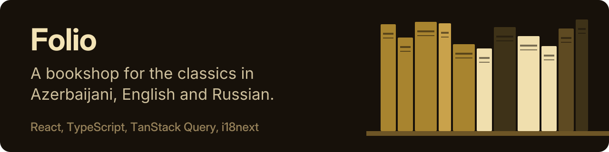
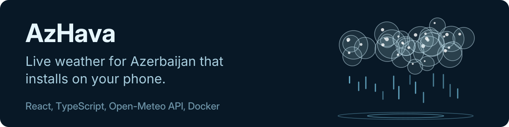

  

  <a href="https://my-portfolio-isamammadli570.netlify.app/"><b>Portfolio</b></a>
  &nbsp;&nbsp;&nbsp;
  <a href="https://www.linkedin.com/in/isa-mammadli-4411aa285/"><b>LinkedIn</b></a>
  &nbsp;&nbsp;&nbsp;
  <a href="mailto:isamammadlee@gmail.com"><b>Email</b></a>

## Projects

Source code: [Folio](https://github.com/isamammadli570/Folio), [AzHava](https://github.com/isamammadli570/AzHava)

## Tools I work with

**Frontend:** React, TypeScript, JavaScript, Redux, TanStack Query, React Router, Tailwind CSS, Bootstrap, HTML, CSS

**Tooling:** Git, Vite, Vitest, ESLint, Netlify, Vercel

**Also:** Node.js, Express, MongoDB, Docker, C++
